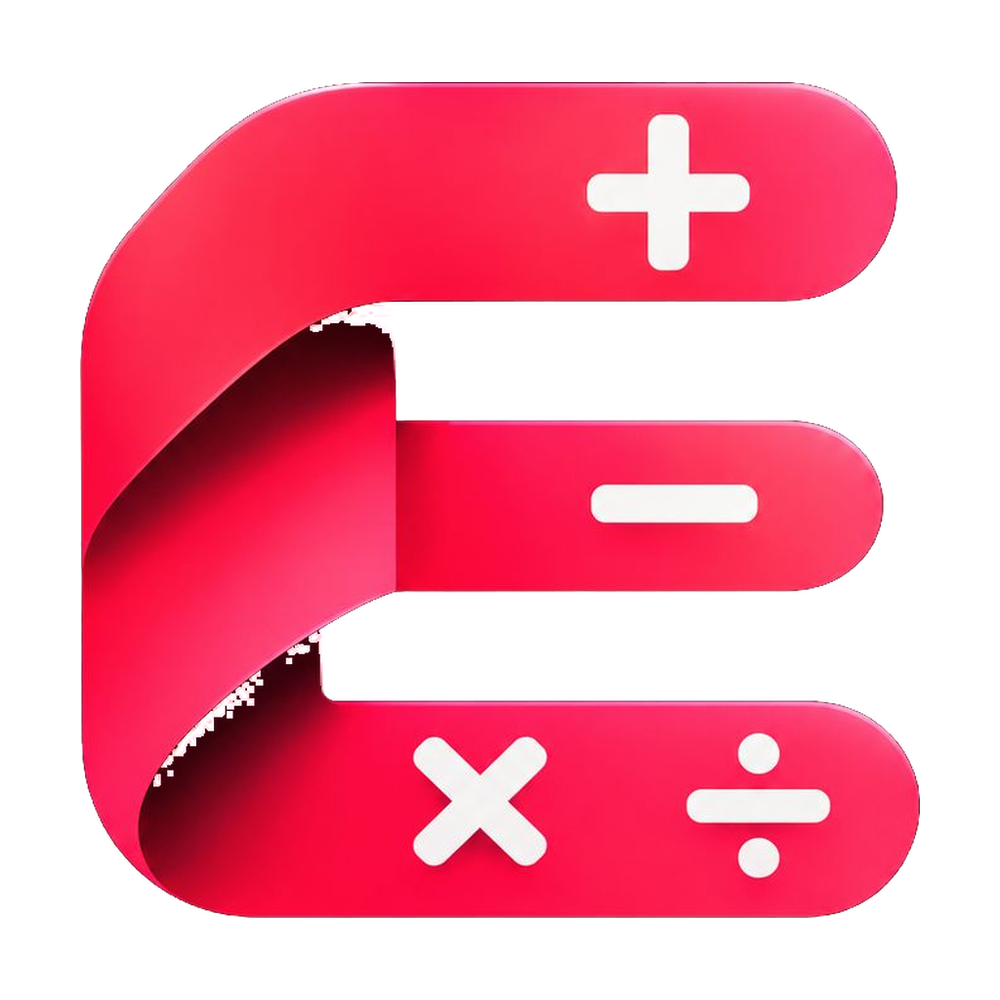

<div align="center">
  




<br/><br/>

**A premium native Android calculator.**
Simple. Smart. Powerful.

<br/>


<br/><br/>

<a href="https://arnoldsemase.dev"></a>

</div>

<br/>

<div align="center">


</div>

<br/>


<table width="100%" cellspacing="6" cellpadding="10">
<tr>
<td width="30%" align="center" bgcolor="#0D0D12"><b>STANDARD</b></td>
<td width="70%" bgcolor="#1A1A23">Brackets, percentages and correct order of operations, shown live as you type.</td>
</tr>
<tr>
<td width="30%" align="center" bgcolor="#0D0D12"><b>SCIENTIFIC</b></td>
<td width="70%" bgcolor="#1A1A23">sin, cos, tan and inverses, ln, log, √, x<sup>y</sup>, x², n!, 1/x, π and e, with DEG / RAD.</td>
</tr>
<tr>
<td width="30%" align="center" bgcolor="#0D0D12"><b>HISTORY</b></td>
<td width="70%" bgcolor="#1A1A23">Every result saved and grouped by day. Copy, reuse, edit or delete, with undo.</td>
</tr>
<tr>
<td width="30%" align="center" bgcolor="#0D0D12"><b>YOUR FORMAT</b></td>
<td width="70%" bgcolor="#1A1A23">Choose thousands separator, decimal mark and maximum decimal places.</td>
</tr>
<tr>
<td width="30%" align="center" bgcolor="#0D0D12"><b>THEMES</b></td>
<td width="70%" bgcolor="#1A1A23">Dark by default, with Light and System options. Optional haptic feedback.</td>
</tr>
<tr>
<td width="30%" align="center" bgcolor="#0D0D12"><b>PRIVATE</b></td>
<td width="70%" bgcolor="#1A1A23">Runs fully on your device. No account, no ads, no tracking.</td>
</tr>
</table>

<br/>


Kotlin · Jetpack Compose · Material 3 · MVVM · Room · DataStore · Navigation Compose. Offline-first, no backend. The only network call is the optional currency-rate download.

```
engine/        ExpressionEvaluator (parser, precedence, DEG/RAD, errors), NumberFormatter
data/          Room history, DataStore settings, repositories
ui/theme       Ember brand tokens (dark + light)
ui/calculator  keypad, display, ViewModel
ui/history     grouped history with copy / use / edit / delete + undo
ui/settings    theme, haptics, number format, about
ui/navigation  NavHost + transitions
```

<br/>

<div align="center">

Part of the **Arnold OS Apps** ecosystem.


<sub>© 2026 Arnold Semase. All Rights Reserved. · <a href="https://arnoldsemase.dev">arnoldsemase.dev</a></sub>

</div>
